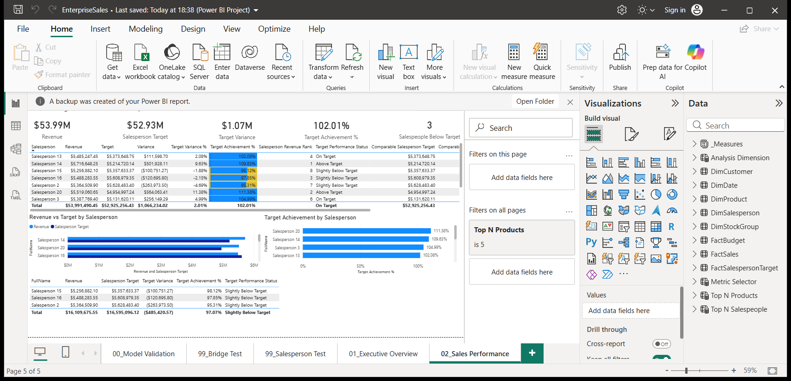

# Enterprise Sales Analytics - Power BI

A native Power BI sales, profitability and planning report built on Microsoft's fictitious Wide World Importers sample and synthetic budgets/targets. The project retains its original **14-table semantic model, 66 DAX measures, nine relationships, five report pages and 59 visuals**.

## Open and refresh

Requirements: Windows, Power BI Desktop, and Python 3.13 for the standard-library launcher. From this directory:

```powershell
py -3.13 scripts/open_native_report.py
```

Then choose **Refresh** in Power BI. On the first open, the project has its complete model/report definitions but no data cache; Refresh loads the included full dataset. If Power BI asks about converting the model to TMDL, keeping the existing format is sufficient.

The launcher creates a machine-specific copy in ignored `.private/native-open/`, configures its `ProjectRoot` automatically, and opens that copy. The public project under `powerbi/native/` retains a neutral placeholder path, so personal machine paths are not written into the publication source.

Alternatively, open `powerbi/native/EnterpriseSales.pbip` directly, set its `ProjectRoot` Power Query parameter to this project directory, and refresh.

## The original model and report

- **228,265 invoice lines**, 70,510 invoices, 663 customer entities, 227 products and ten salespeople.
- The original fact grain, date dimension, customer/product/salesperson dimensions and product-to-stock-group bridge remain intact.
- Monthly company budgets and annual salesperson targets retain their distinct grains and relationships.
- All original DAX expressions are retained, including YTD/PYTD, rolling revenue, weighted margin, selected-context rankings, comparable-period targets and Top-N controls.
- Executive Overview and Sales Performance are the presentation pages. The original model-validation, bridge-test and salesperson-test pages are retained for inspection.



This screenshot is from the reconstructed report running in Power BI Desktop, after an actual model refresh.

## Source and refresh workflow

The self-contained refresh mode uses full anonymous source snapshots extracted through the original report's native model engine. They are not smaller simulated data or aggregate-only substitutes. Transactions and descriptive dimensions load from `data/model/`; the model's original measures and relationships perform the analysis.

Planning inputs remain live: `FactBudget` imports `data/budget/Monthly_Budget.xlsx` through the original unpivot/date-building Power Query workflow, and `FactSalespersonTarget` imports `data/targets/Salesperson_Targets.csv`. Monetary budget columns use currency types so fractional amounts are preserved. Editing these planning files and refreshing changes the report.

The original SQL Server preparation views remain under `sql/`, with the SQL-source Power Queries under `powerbi/queries/`. They provide the separate database-connected workflow after restoring Wide World Importers. The native snapshot mode does not require SQL Server. SQL Server view execution was not part of the native verification recorded here.

## Verification

The reconstructed PBIP was opened and refreshed in Power BI Desktop. **56 native DAX checks passed**, using independent full-data CSV/Decimal reference calculations. They cover totals, weighted margin, annual filters, previous-year and partial-year calculations, comparable targets, rolling windows, salesperson filtering, bridge groups/multi-select union behavior and anonymous labels/contact removal.

Seven Python recovery tests also passed, covering original DAX/model preservation, full fact/key reconciliation, anonymous labels, workbook metadata integrity and private-copy isolation.

The Executive Overview budget-attainment card is bound to the existing Comparable Budget Attainment % measure, aligning the comparison to the budget-covered period and last sales date. The raw full-period budget measures remain available unchanged.

The original revenue is 172,261,341.20 and gross profit is 85,729,180.90; both reconcile after native refresh. These are sample-data totals, not employer outcomes. See [native DAX verification](reports/native_dax_verification.json) and [verification scope](docs/verification.json).

The native Excel connector exposed an invalid date-type namespace in the anonymized workbook's Office metadata. This was repaired while preserving every non-metadata ZIP member byte for byte. Native Excel import and the DAX checks subsequently passed.

For development checks:

```powershell
py -3.13 -m pip install pytest openpyxl
py -3.13 -m pytest -q tests/test_native_recovery.py
py -3.13 scripts/validate_supporting_data.py
```

The PowerShell scripts under `scripts/` support native export, refresh and DAX regression checks against a chosen local report endpoint. They do not publish to Power BI Service.

## Data and publication

Customer, salesperson and supplier identity labels are neutralized; salesperson email and phone fields are blank. Keys, financial values and non-identifying business/geographic attributes are retained. The data is Microsoft's fictitious sample, with synthetic planning assumptions.

Source attribution and the Microsoft sample license are retained in `docs/licenses/`. Original reports, raw identity-bearing exports and local Power BI caches stay in ignored `.private/` and are excluded from the release ZIP. No private model cache is needed in the publication package: the included source inputs support a complete refresh.

Run `py -3.13 scripts/package_native_release.py` to create the source/data portfolio ZIP.
